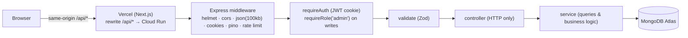

# Doctor Tracker — Backend API

> This repository is the **Express + MongoDB REST API**. The Next.js web app lives in **[Doctor-Tracker-Frontend](https://github.com/fahimor/Doctor-Tracker-Frontend)**.


## Description

**Doctor Tracker** is a secure admin portal for managing doctors, the patients under their care, and clinical analytics. This service is its stateless REST API. It handles cookie-based JWT authentication and role-based authorization (admin or viewer); input validation with Zod; indexed search, filtering and pagination for doctors and patients; and the aggregation pipelines that feed the analytics dashboard. It runs as a Docker container on **Google Cloud Run** against **MongoDB Atlas**.

| | |
| --- | --- |
| **Runtime** | Node.js 24, Express 5, TypeScript (ESM) |
| **Database** | MongoDB with Mongoose 9 |
| **Validation** | Zod 4 (body, query and params, all typed) |
| **Security** | JWT (HS256) in an httpOnly cookie, bcrypt, Helmet, CORS allow-list, rate limiting |
| **Observability** | Pino JSON logs with a Cloud Logging `severity` field, `/health` endpoint |
| **Testing** | Vitest + Supertest + mongodb-memory-server (20 integration tests, including `explain()` index checks) |
| **Hosting** | Google Cloud Run (multi-stage Dockerfile, non-root) · MongoDB Atlas |

**Demo accounts** (created by `npm run seed` or `npm run dev:memory`):

| Role | Email | Password |
| --- | --- | --- |
| Admin | `admin@doctortracker.dev` | `Admin@12345` |
| Viewer (read-only) | `viewer@doctortracker.dev` | `Viewer@12345` |

---

## Setup Guide

### Prerequisites

- Node.js **20.12+** (built and tested on 24)
- One of these MongoDB options:
  - **None:** `npm run dev:memory` starts an in-memory MongoDB and seeds it.
  - MongoDB Atlas, or
  - a local MongoDB (`docker compose up -d` uses the included `docker-compose.yml`)

### Steps

```bash
git clone https://github.com/fahimor/Doctor-Tracker-Backend.git
cd Doctor-Tracker-Backend
npm install
cp .env.example .env          # set MONGODB_URI and JWT_SECRET (32+ characters)
```

Every variable is documented in [`.env.example`](.env.example).

```bash
# A) zero setup: in-memory MongoDB + demo data, API on http://localhost:8080
npm run dev:memory

# B) your own MongoDB
npm run seed                  # demo users + 48 doctors + 1,600 patients (wipes doctors/patients)
npm run dev                   # watch mode
```

Then start the [frontend](https://github.com/fahimor/Doctor-Tracker-Frontend) (`npm run dev`, which proxies `/api` to `:8080`) and open <http://localhost:3000>.

### Scripts

| Script | Purpose |
| --- | --- |
| `npm run dev` | API in watch mode (`tsx`) |
| `npm run dev:memory` | In-memory MongoDB + seed + API |
| `npm run seed` | Seed demo data (refuses in production unless `--force` is passed) |
| `npm run db:indexes` | Make the database's indexes match the schemas (creates missing ones, drops stale ones) |
| `npm run db:recount` | Rebuild every doctor's `patientCount` from the patients collection (backfill or repair) |
| `npm test` | Integration tests |
| `npm run typecheck` | `tsc --noEmit` |
| `npm run build` / `npm start` | Compile to `dist/` / run the compiled server |

---

## System Architecture



- **Layering:** `routes → middleware → controller → service → model`, organised as one folder per domain (`modules/auth`, `doctors`, `patients`, `dashboard`, `users`).
- **Errors:** every failure returns `{ error: { code, message, details? } }`. Zod errors become 400 responses with field paths, duplicate keys become 409, and unknown errors become a generic 500 with the details logged server-side only.
- **Stateless:** the identity travels in the JWT, so Cloud Run can scale to many instances. Each instance holds one Mongo connection pool and shuts down cleanly on `SIGTERM`.

```
src/
├── app.ts / server.ts        app factory (used by tests) / boot + graceful shutdown
├── config/                   env (validated with Zod at startup), db pool, logger
├── middleware/               auth, validate, error handler
├── modules/
│   ├── auth/                 login · logout · me
│   ├── users/                User model
│   ├── doctors/              model+indexes · schema · service · controller · routes
│   ├── patients/             model+indexes · schema · service · controller · routes
│   └── dashboard/            aggregation pipelines
├── utils/                    search tokens, pagination, dates, ApiError, validators
└── scripts/                  seed, in-memory dev server
tests/                        Vitest + Supertest
```

---

## REST API

Base path: `/api`. Every route except `/auth/login` and `/auth/logout` requires a session cookie (or `Authorization: Bearer <jwt>`). 🔒 means the `admin` role is required.

| Method | Path | Description |
| --- | --- | --- |
| `POST` | `/auth/login` | Sign in; sets the `dt_session` httpOnly cookie (rate limited: 10 failures / 15 min) |
| `POST` | `/auth/logout` | Clear the cookie |
| `GET` | `/auth/me` | Current user |
| `GET` | `/dashboard/stats?range=7d\|30d\|90d\|12m` | Totals, admissions trend, conditions, top-10 caseloads, specializations, demographics |
| `GET` | `/doctors?page&limit&q&specialization&hospital&from&to&sort` | Paginated list with `patientCount`. `sort`: `newest`, `oldest`, `name_asc`, `name_desc`, `patients_desc`, `patients_asc` |
| `GET` | `/doctors/facets` | Distinct specializations and hospitals |
| `GET` | `/doctors/options?q&limit` | Lightweight list for pickers |
| `POST` 🔒 | `/doctors` | Create |
| `GET` | `/doctors/:id` | Detail and patient stats by condition |
| `PATCH` 🔒 / `DELETE` 🔒 | `/doctors/:id` | Update / delete (deleting also removes the doctor's patients) |
| `GET` | `/doctors/:id/patients?…` | That doctor's patients (same filters as `/patients`) |
| `POST` 🔒 | `/doctors/:id/patients` | Add a patient under this doctor |
| `DELETE` 🔒 | `/doctors/:id/patients/:patientId` | Remove a patient from this doctor's list |
| `GET` | `/patients?page&limit&q&condition&gender&doctor&from&to&minAge&maxAge&sort` | Paginated list |
| `POST` 🔒 | `/patients` | Create (body includes `doctor`) |
| `GET` / `PATCH` 🔒 / `DELETE` 🔒 | `/patients/:id` | Read / update or reassign / delete |
| `GET` | `/health` | `{"status":"ok","db":"up"}`, or 503 if the database is down |

```bash
curl -c cookies.txt -H 'Content-Type: application/json' \
  -d '{"email":"admin@doctortracker.dev","password":"Admin@12345"}' http://localhost:8080/api/auth/login
curl -b cookies.txt 'http://localhost:8080/api/patients?condition=critical&from=2026-06-01&sort=age_desc'
```

---

## Technical Decisions

### 1. Indexed token-prefix search and ESR compound indexes

A case-insensitive "contains" regex (`/rah/i`) cannot use an index, so it scans the whole collection. Instead, each document stores `searchTokens`, the lower-cased words of its searchable fields, maintained by a `pre('save')` hook and covered by a **multikey index**. The query `"rah card"` becomes `{ searchTokens: { $all: [/^card/, /^rah/] } }`. Anchored, case-sensitive regexes become index range scans. User input is regex-escaped, and the longest term goes first because it is the most selective.

Every filter and sort combination has a compound index that follows **ESR** (Equality, Sort, Range), for example `{ condition: 1, admissionDate: -1, _id: -1 }` and `{ doctor: 1, admissionDate: -1, _id: -1 }`. `_id` is the last sort key so pages are stable, and it is also the last index key, so a page streams straight from the index. Without it MongoDB reads every match and sorts in memory: on Atlas that was 117 documents read for a 10-row page of critical patients, and now it is 10. A test runs `explain()` on every list sort and asserts the expected index is used with **no in-memory SORT stage**.

Mongoose creates missing indexes on startup but never drops old ones, so after changing an index run `npm run db:indexes` (or `npm run db:indexes:prod` from the compiled build).

The list endpoints follow the same approach:
- the page query and the count run in parallel (`Promise.all`), and the count is O(1) via `estimatedDocumentCount()` when no filter is applied;
- reads use `lean()`;
- each doctor stores a denormalised `patientCount`, kept in sync with atomic `$inc` on every patient create, delete and reassignment. Sorting by most or fewest patients is then a plain index read on `{ patientCount: -1, _id: -1 }`, and the list needs no per-page counting query. `npm run db:recount` rebuilds the counters from the patients collection if they ever drift;
- there are no N+1 queries: doctor names on patient rows come from one `$in` populate per page.

### 2. JWT in an httpOnly cookie, served first-party through the frontend's rewrite

The token is never exposed to JavaScript, which rules out XSS token theft. The frontend proxies `/api/*` to this service, so the cookie (`HttpOnly; Secure; SameSite=Lax`) is first-party on the Vercel domain. That avoids third-party-cookie blocking and CORS preflights, and it lets the frontend's `proxy.ts` protect pages before they render.

Further hardening:
- `jwt.verify` pins `HS256` and checks the issuer and audience;
- bcrypt (cost 12) is compared against a dummy hash for unknown emails, so login takes constant time and reveals nothing about which accounts exist;
- writes are guarded server-side by `requireRole('admin')`.

**Trade-off:** sessions are stateless (12-hour expiry). The next step for instant revocation would be a `tokenVersion` field or refresh-token rotation.

### Dashboard aggregations

About 9 queries run in parallel:
- the three patient breakdowns (condition, gender, age `$bucket`) share **one `$facet` pass**;
- the "heaviest caseloads" list reads the top 10 straight from the `patientCount` index instead of grouping every patient;
- the admissions trend uses `$dateTrunc` (day, week or month), and the server fills empty buckets so the timeline is continuous.

At large scale these would move to a precomputed collection refreshed with `$merge`.

---

## Testing

```bash
npm test
```

The 20 tests cover:
- auth: cookie flags, wrong password, tampered token, validation, viewer gets 403;
- doctors: pagination metadata, prefix search, filters, create/update/delete, duplicate email returns 409;
- the nested doctor→patients routes, including that a patient can't be deleted through another doctor's URL;
- patient filters and sorting, and search tokens refreshed on update;
- dashboard aggregation totals;
- query-plan assertions with `explain()`.

---

## Deployment (Google Cloud Run)

```bash
gcloud run deploy doctor-tracker-api \
  --source . --region asia-south1 --allow-unauthenticated --port 8080 \
  --set-env-vars "NODE_ENV=production,TRUST_PROXY=2,CORS_ORIGINS=https://your-app.vercel.app" \
  --set-secrets "MONGODB_URI=mongodb-uri:latest,JWT_SECRET=jwt-secret:latest"
```

The full walkthrough (Atlas, Secret Manager, Cloud Run, Vercel, troubleshooting) is in **[docs/DEPLOYMENT.md](docs/DEPLOYMENT.md)**.

## Visual Evidence

UI screenshots (desktop and mobile) are in the [frontend README](https://github.com/fahimor/Doctor-Tracker-Frontend#visual-evidence).
